**HACKMINDS LINUX CHALLENGE #002**

- **TASK 1 --- BUILT THE INVESTIGATION WORKSPACE**

I created the main directory **"HACKMINDS_CASE"** and all required
subdirectories while ensuring each directory is located in the correct
parent directory. The directory structured was verified using the
***"tree"*** command.

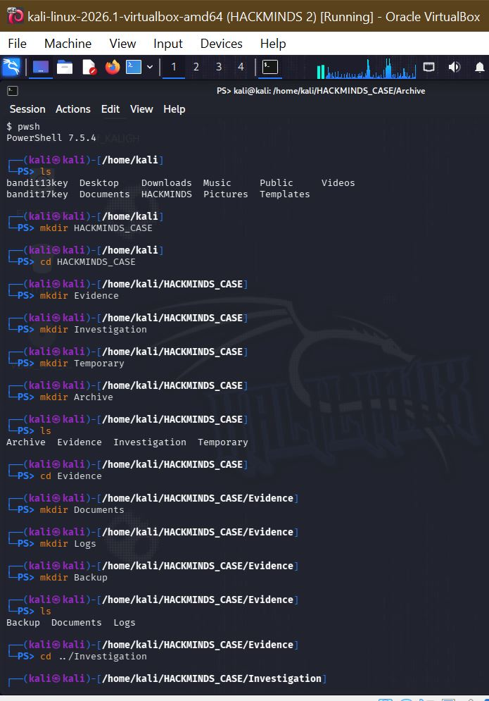{width="4.958333333333333in"
height="5.944444444444445in"}

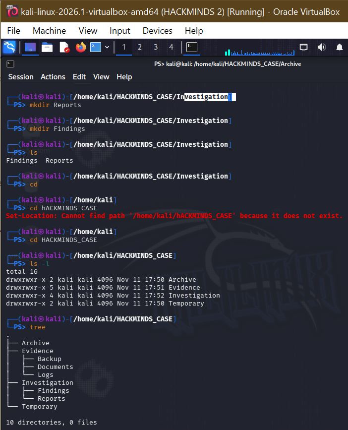{width="4.486111111111111in"
height="5.381944444444445in"}

- **TASK 2 --- CREATED AND VERIFIED THE EVIDENCE FILES**

I created various files up to five (5) under different subdirectories
for the investigation path and write on the files, the corresponding
contents using the ***"echo"*** command and sent to the files path with
the **STDIN** "\>" command, while placing them in their respective
directories and ensured the contents matched by verifying and displaying
the files' contents thereof.

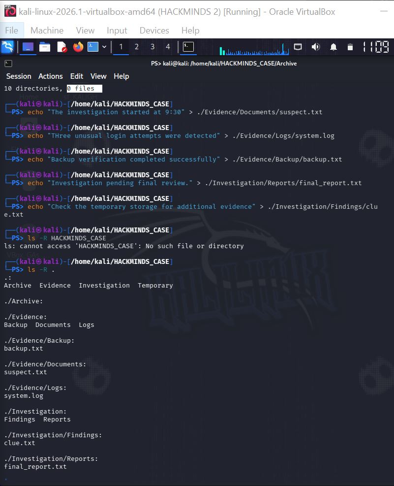{width="4.979166666666667in"
height="6.284722222222222in"}

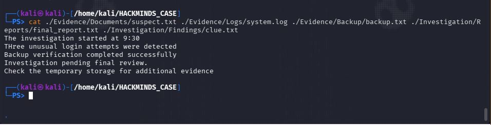{width="6.013888888888889in"
height="1.534955161854768in"}

- **TASK 3 --- INVESTIGATED THE HIDDEN EVIDENCE**

A hidden evidence file was created in the **"Evidence/Documents"**
directory using ***"touch"*** command. This was done by adding period
**"."** sign at the beginning of the file name to automatically make it
hidden. The file was verified and displayed using hidden files listing
command option ***"ls --la"***. ***"cat"*** command was used to display
the hidden file's content. To locate the hidden file from the working
directory **"HACKMINDS_CASE"**, ***"find --type f --name"*** command was
used alongside the filename as an argument.

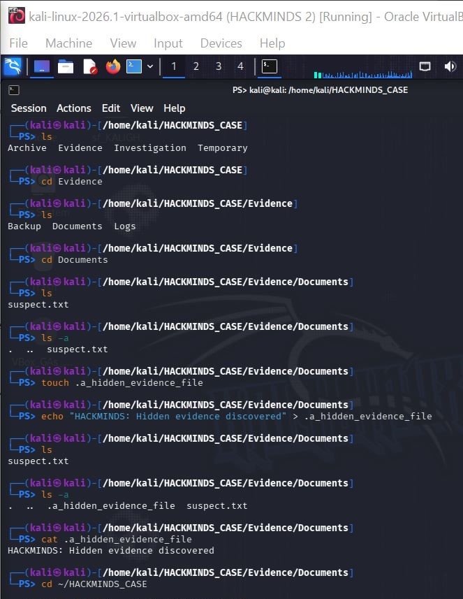{width="4.604166666666667in"
height="5.951388888888889in"}

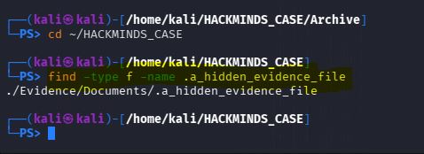{width="3.3194444444444446in"
height="1.2083333333333333in"}

- **TASK 4 --- TEMPORARY FILE MANAGEMENT**

From the working directory **"HACKMINDS_CASE/Temporary"**, the first
temporary file was created with the content using the ***"touch"***
command, renamed to a different filename using the ***"mv old_filename
new_filename"*** command, then removed with the ***"rm"*** command.

A second temporary file was created with the content verified and
displayed.

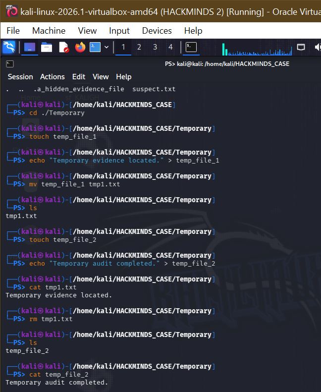{width="4.5in"
height="5.493055555555555in"}\\

- **TASK 5 --- FILE PERMISSIONS AND ACCESS CONTROL**

To secure the investigation report, the target file
**"final_report.txt"** was configured with the owner's permissions only
using the ***"chmod +u=rw, g=, o="*** command alongside the filename as
the argument while the group and other users have no permission. The
permission string was verified and the numeric value was identified
using the ***"stat"*** command. Finally, the permissions for
**"suspect.txt"** file saved in **Evidence/Documents** directory was
inspected, while the original evidence file remains intact.

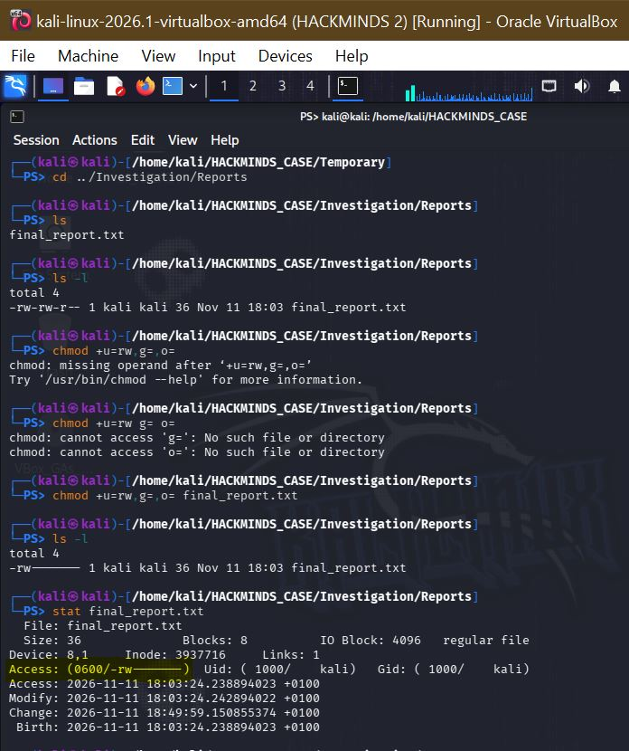{width="4.6547933070866145in"
height="5.069444444444445in"}

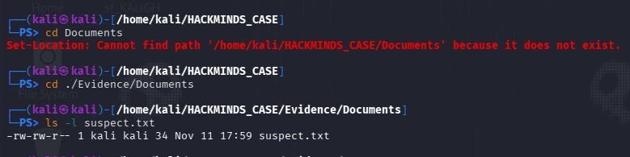{width="5.020833333333333in"
height="1.2430555555555556in"}

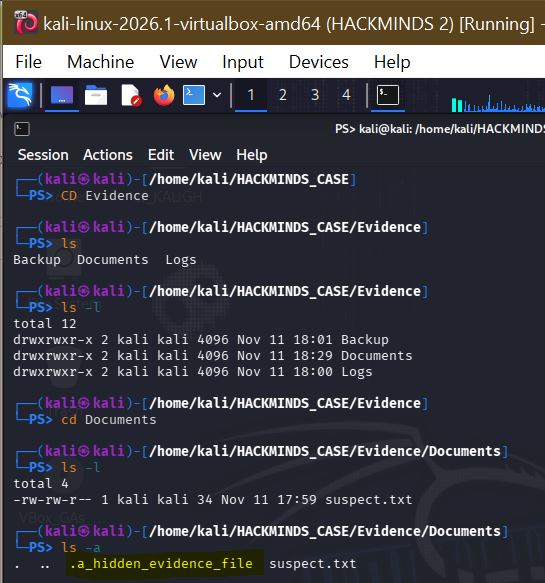{width="3.4385279965004374in"
height="3.5625in"}

- **TASK 6 --- FILE SYSTEM SEARCH AND AUDIT**

A file system audit was conducted from the main **"HACKMINDS_CASE"**
directory.

**"system.log"** file was located using the ***"find --type --name
system.log"*** command.

A search was done to find the phrase **"investigation"** using the
***"grep --r investigation"*** command. All regular files were
identified within the case directory and subdirectories.

File count was carried out using the ***"wc --l"*** command to verify
the total number of regular files within the entire **"HACKMINDS_CASE"**
directory and its subdirectories.

Backup file was investigated by displaying the contents in the
**"backup.txt"**. And the remaining file in the **"Temporary"**
directory were identified.

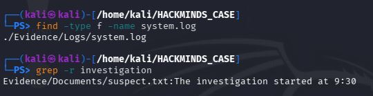{width="3.75in"
height="0.9652777777777778in"}

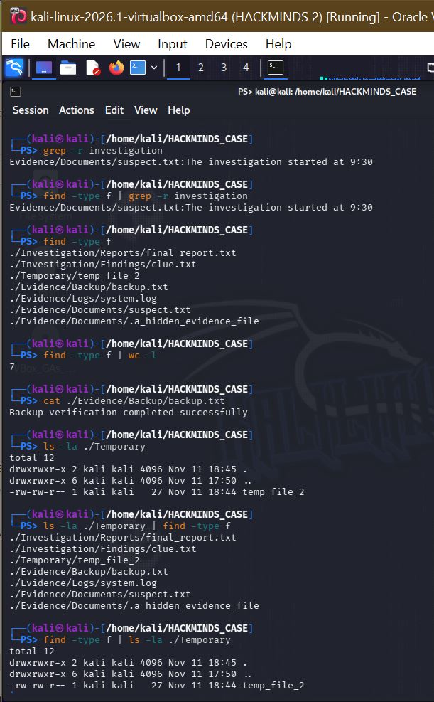{width="4.090277777777778in"
height="6.111111111111111in"}

- **TASK 7 --- ARCHIVING AND INTEGRITY VERIFICATION**

In the Target Directory **\"HACKMINDS_CASE/Archive\"**, a compressed
archive of the entire **\"Evidence\"** directory was created using the
***"tar --czvf archived_file original_filename_path"*** command and
stored in the **"Archive"** directory. The archive was verified, its
contents displayed using the **"tar --tvf"** command and a checksum for
the archive was generated using the ***"sha256sum"*** command.

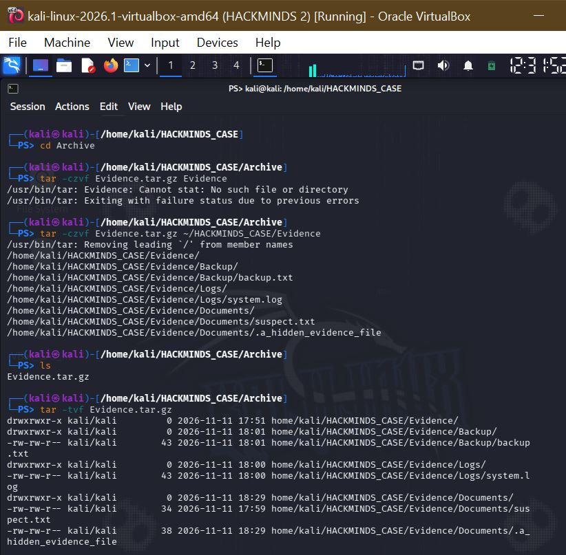{width="5.708333333333333in"
height="5.604166666666667in"}

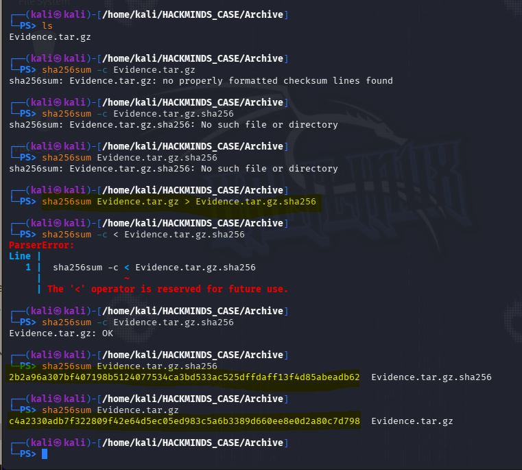{width="5.284722222222222in"
height="4.756944444444445in"}

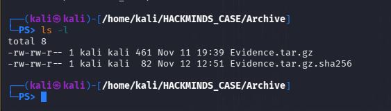{width="3.9097222222222223in"
height="1.1111111111111112in"}

**NB: ALL ORIGINAL EVIDENCE DIRECTORY REMAIN INTACT.**

**KNOWLEDGE ASSESSMENT**

**Question 1**: **What is the difference between a regular file and a
directory in Linux?**

**Answer:** A regular file contains text or binary that is readable
directly and can be opened with the \"cat\" command while a directory is
like a folder that houses other folders or files. A directory can be
accessed using the \"cd\" command.

**Question 2: Why are hidden files useful in Linux?**

**Answer:** Hidden files could contain some system configurations or
logs that are not directly interacted with by the user. It is hidden to
avoid being tampered with, modified or accidentally deleted, also not to
clog the workspace with unused files.

**Question 3: What is the purpose of temporary files, and why should
they be managed carefully?**

**Answer:** They store information needed temporarily during the working
state without altering the system configurations. They can serve as
drafts and recovery during work. Some are being deleted on reboot while
some can be deleted manually by the user.

**Question 4: What does the permission value \"600\" represent?**

**Answer:** It means only the owner of the file has the permission to
read and write on the file while other users or group users have no
permission whatsoever. Read = 4, write = 2 in the permission numeric
value.\
\
**Question 5: Why is it important to verify file permissions after
changing them?**

**Answer:** For confirmation purpose and to ensure no unathorized access
to the file.

**Question 6: What is the difference between a compressed archive and an
ordinary directory?**

**Answer:** A compressed archive is like a zipped folder that has to be
extracted in order to access the embedded files and has been reduced in
size due to removal of redundant attributes. It usually ends with the
compressed format tag (gz, zip, bz2) while ordinary directory store
files in its original formats and do not need to be unzipped to access.

**Question 7: What is the purpose of generating a checksum for an
archive?**

**Answer:** To ensure the archive has not been tampered with or altered
as a checksum assigned digits that prove the originality/integrity of
the archive.

**Question 8: Why should original evidence files remain unchanged during
an investigation?**

**Answer:** To maintain integrity and ensure it has not been tampered
with. It also helps in the process of recovery of original information
needed for further investigation.
