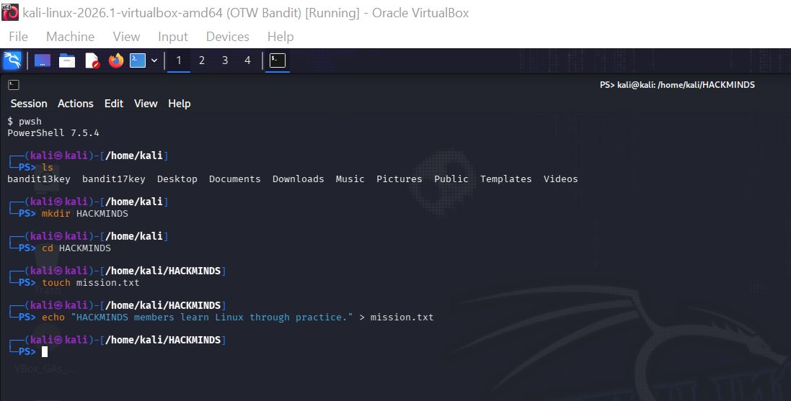
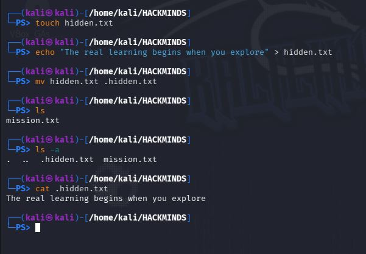
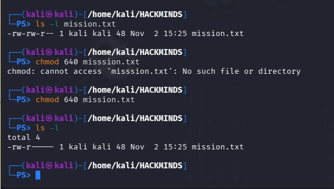
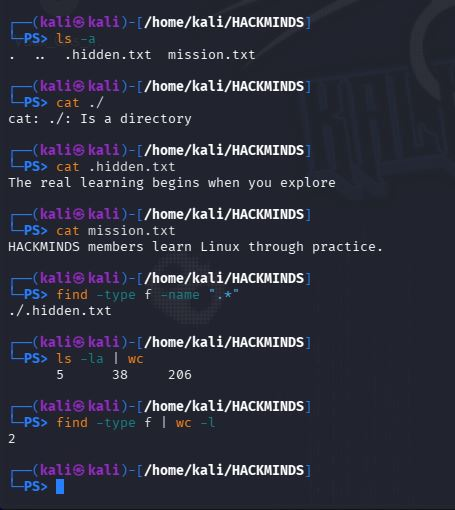

**HACKMINDS LINUX CHALLENGE #001**

- **LEVEL 1 -- Directory and File Creation**

> I created a directory named "HACKMINDS" using the ***"mkdir"***
> command, changed working directory with the ***"cd"*** command and
> created a file named "mission.txt" in the "HACKMINDS" working
> directory and write on the file using ***"echo"*** command.

- **LEVEL 2 --- Hidden File Investigation**

In the same directory, I created a second text file and make it hidden
by adding **period (*".")*** character at the beginning of the file
name. I demonstrated the difference between a normal directory listing
and a listing that includes hidden files, using the ***"ls"*** and
***"ls --a"*** commands respectively. The hidden file's content was
displayed thereafter using the ***"cat"*** command.

- **LEVEL 3 --- File Permissions**

I inspected the permissions of the "mission.txt" file using the ***"ls
--l"*** command, changed the permissions of the file using the
**"chmod"** command together with the numeric value of the required
permission (i.e. chmod **640** mission.txt). The expected permissions
was verified in the terminal output.

- **LEVEL 4 --- Final Investigation**

<!-- -->

- All files in the "HACKMINDS" directory were displayed using the ***"ls
  --a"*** command and the contents of the files were also displayed
  using the ***"cat"*** command followed by the file name.

- Hidden file was identified by using the ***"find"*** command together
  with the options ***"-type"*** (for document type) and ***"-name"***
  (to submit list of filenames to the shell).

**NB: ".\*" was used as a glob character to indicate any file that
starts with the period (.) sign, since any file name preceded by a
period sign is considered a hidden file automatically by the shell.**

- Regular files were firstly counted using the **"ls --la \| wc"**,
  however, this command only counted the total number of lines,
  characters and bytes of all the text files in the directory,
  therefore, the command ***"find --type f* \| *wc --l"*** was used to
  count the number of regular files and not the size.

> **NB: "find --type f" looked for the regular files and results was
> passed to "wc --l" command using the pipe (\|) option.**
>
> 
>
> **PART B -- [Knowledge Questions.]{.underline}**
>
> **1. What makes a file hidden in Linux?**
>
> [Answer:]{.underline} A file is hidden when the file name starts with
> period (.) sign.
>
> **2. Does hiding a file mean that it is encrypted or
> password-protected?**
>
> [Answer:]{.underline} No, a hidden file doewsnt's mean it is encrypted
> or protected. It can be view with the "ls --la" command.
>
> **3. What is the difference between a normal directory listing and one
> that includes hidden files?**
>
> [Answer:]{.underline} The normal directory listing does not include
> option "-a", just "ls" command, while the one that includes hidden
> files includes "ls --a".
>
> **4. What does the permission string \"-rw-r\-\-\-\--\" mean?**
>
> [Answer:]{.underline} Document type = file; owner permission = read
> and write only; group permission = read only; and other permission =
> no permission.
>
> **5. What is the numeric permission value of \"-rw-r\-\-\-\--\"?**
>
> [Answer:]{.underline} 640 (read -- 4; write -- 2; execute - 1).
>
> **6. Why are file permissions important in Linux?**
>
> [Answer:]{.underline} It is important so that unauthorized user won't
> have access to the file.
