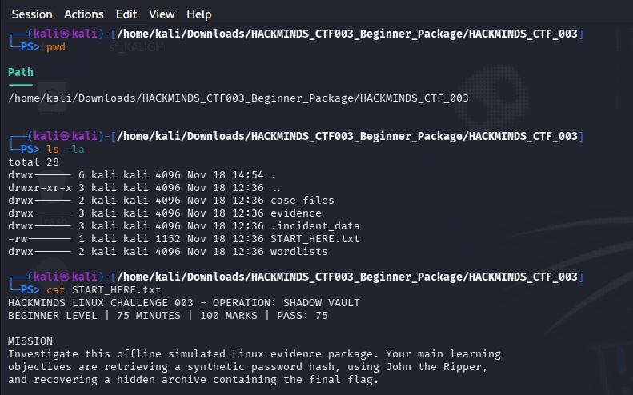
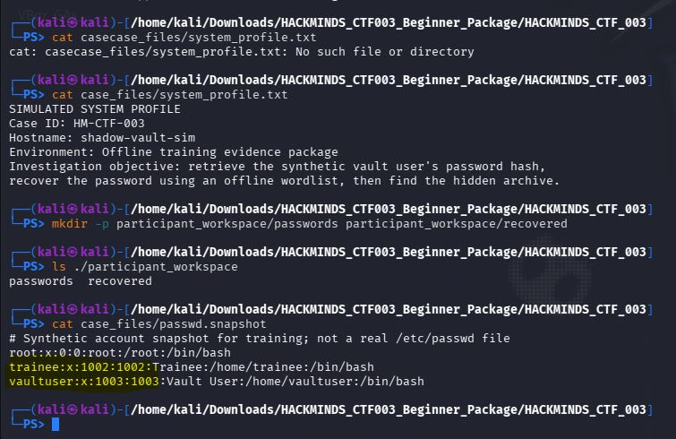
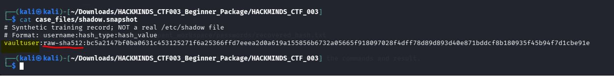
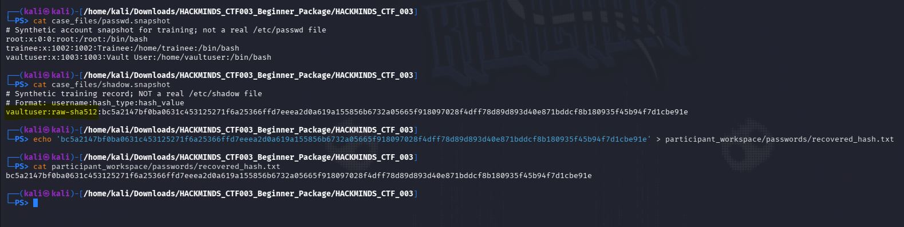
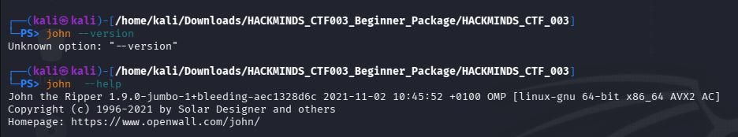
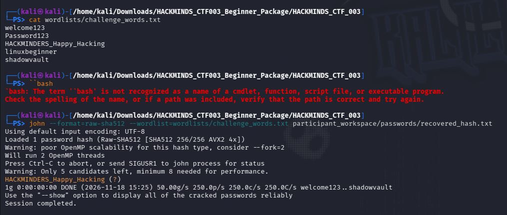
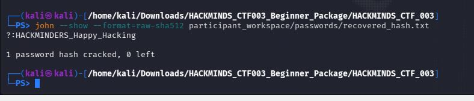
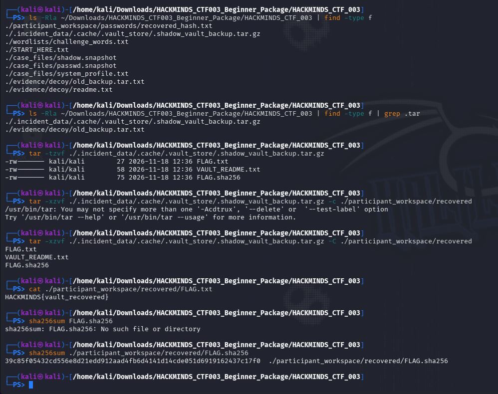

**OPERATION: SHADOW VAULT**

- **TASK 1 --- LINUX BASICS AND WORKSPACE**

I entered the **"HACKMINDS_CTF_003"** directory via the download path
with the ***"cd directory_path"*** command. ***\`pwd\`*** was used to
confirm the current location, then ***\`ls -la\`*** to list ordinary and
hidden entries inside the directory, and ***\`cat\`*** to read the
**\`START_HERE.txt\`** and **\`case_files/system_profile.txt\`** files.

**\`participant_workspace\`** directory was created with
**\`passwords\`** and **\`recovered\`** subfolders using ***"mkdir
--p"*** command. I Inspected **\`case_files/passwd.snapshot\`** file and
identified the simulated account names and UIDs (as highlighted below in
yellow).

- **TASK 2 --- PASSWORD HASH INVESTIGATION AND RETRIEVAL**

**\`case_files/shadow.snapshot**\` file was read using the ***"cat"***
command, the target account and its hash type was identified
(highlighted in yellow and underlined in red respectively).

**Password hash** is a system way of storing or representing the
original password with a long string of characters known as hashing and
it is done for a security check purpose in order to protect the actual
password. The system checks the hash against the real password whenever
it is entered to validate it.

The supplied file is a simulation rather than a real **\`/etc/shadow\`**
file because it's for learning purposes and not to compromise data in
the real **/etc/shadow** file as it contains protected confidential
data.

After identifying the hash type, the hash value was extracted and saved
to **\`participant_workspace/passwords/recovered_hash.txt\`.** Check was
carried out to confirm the saved file contains the hash and no username,
label or extra text.

- **TASK 3 --- PASSWORD RECOVERY WITH JOHN THE RIPPER**

TO check whether John the Ripper is installed, I firstly used ***\`john
\--version\`*** command but returned with an error message, then I used
***"john --help"*** command to confirm and it was OK.

I located and inspect **\`wordlists/challenge_words.txt\`** file using
the ***"cat"*** command. Then, run *"**john"*** using the supplied
wordlist and the extracted hash file ***(john \--format=raw-sha512
\--wordlist=wordlists/challenge_words.txt
participant_workspace/passwords/recovered_hash.txt)***.

A **wordlist** is a file that contains a list of possible passwords. It
is used to test different password guesses to see if any of them match a
stored password hash.

Raw SHA-512 is different from Linux SHA-512 Crypt (\$6\$). Raw SHA-512
is a direct hash, while \$6\$ is a special Linux password-hashing
format.

The ***"john"*** password hash result was displayed by passing the
command ***"john \--show \--format=raw-sha512
participant_workspace/passwords/recovered_hash.txt"***.

- **TASK 4 --- HIDDEN ARCHIVE DISCOVERY AND FLAG RECOVERY**

The challenge folder was searched recursively, including hidden
directories, for the archive, and the suspected archive file was
identified using ***"ls --Rla 'directory_path',*** command then piped to
***"find --type f"*** command and finally to filter ***"grep"*** command
with the file extension (.tar) as the argument.

The contents of the archive file were listed before extracting it using
***\`tar -tzvf\`*** command, then extracted into
**\`participant_workspace/recovered\`** path using ***\`tar -xzvf
\<archive-path\> -C participant_workspace/recovered\`***.

The flag was located in the recovered files, opened and the checksum
hash was verified.

