**Step by step of how I retrieved the password to the next level from
the previous level.**

**Level 11 -- 20.**

**At** **level 11**, I used ***\"cat\"*** to view the file, then pipe it
to translate command ***\"tr\"*** and rotate in 13 positions.

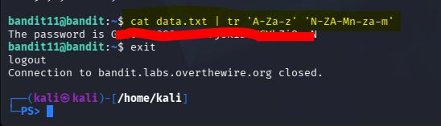

**At Level 12**, I created a random temporary directory using the
***\"mktemp -d\"*** file, changed ***\"cd\"*** into the directory, then
I copied ***\"cp\"*** the file from my home directory into the temporary
directory created. I converted from the hexdump file to raw file using
the ***\"xxd\"*** command. I identified the file type using
***\"file\"*** command and after confirming the file type, I used the
associated compress and archive commands (i.e. gzip, bzip2, tar) to
compress, decompress and extract the file from archive step by step,
several times until I arrive at a **\"ASCII text\"** file format, then I
used ***\"cat\"*** command to view the file.

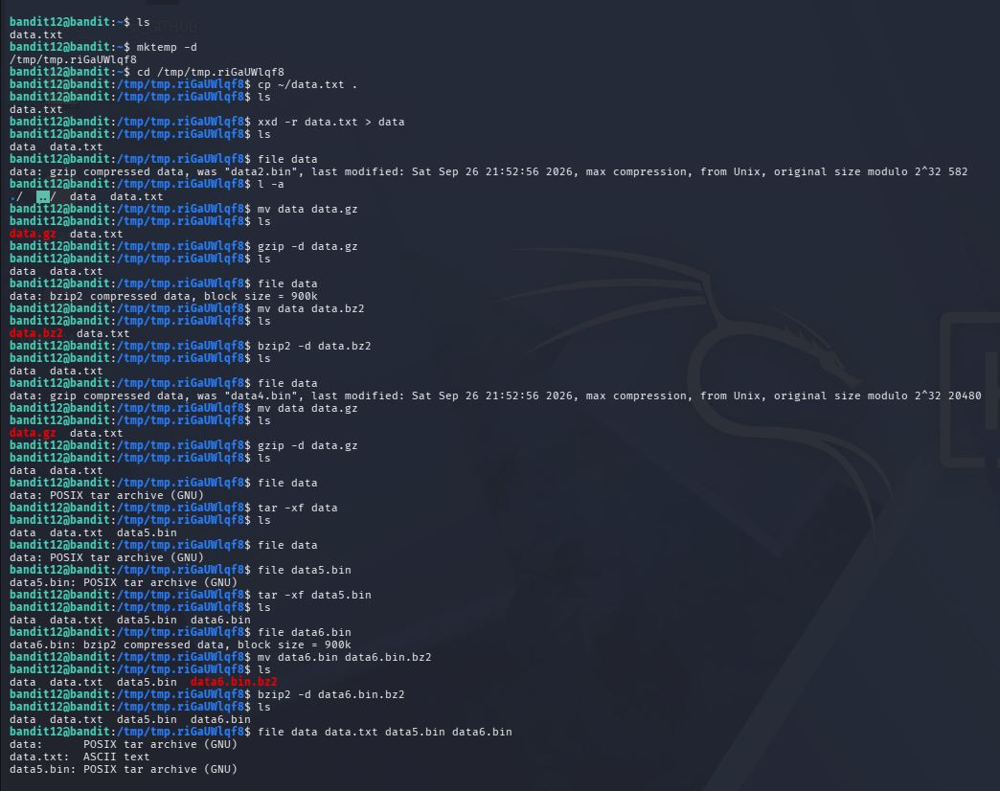 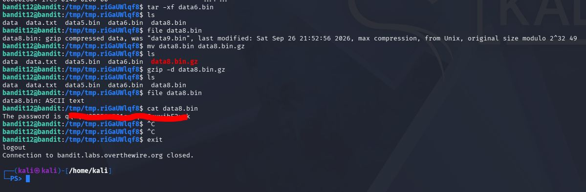

**At Level 13,** I opened the SSH Private key file on ***bandit13***
user's directory using ***\"cat\"*** and copied the entire text from
beginning to the end.

I exited the OTW server, and on my localhost, I created a file with the
copied SSH Private key text using nano.

I used the ***\"ssh\"*** command to access the remote server specifying
the file where I stored the previously copied private key as an option
together with the user directory and OTW server name ***(i.e. ssh -i
\~/bandit13key -p 2220
bandit13@bandit14@bandit.labs.overthewire.org).***

I used the ***\"cat\"*** command to open the file that contained the
level 14 password as stated on the OTW Bandit Challenge site.

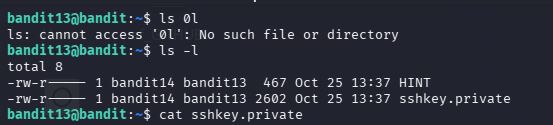 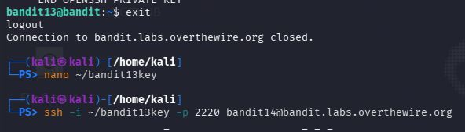

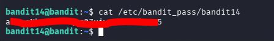

**At Level 14,** I opened the file that contained the password to level
14 and copied it. Then submitted it to port 30000 using the
***\"nc\"(network connections)*** command via the localhost connection.

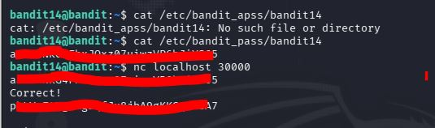

**At Level 15,** I submitted level 15 password to port 30001 on
localhost using SSL/TLS encryption command ***(i.e openssl s_client
-connect localhost:30001).*** I used the displayed password to access
level 16.

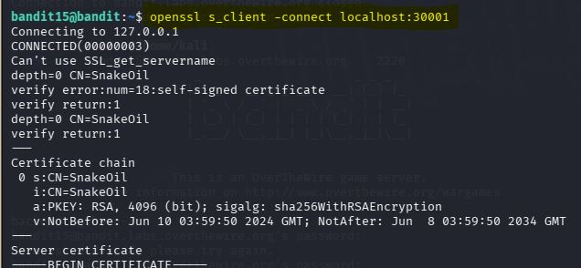 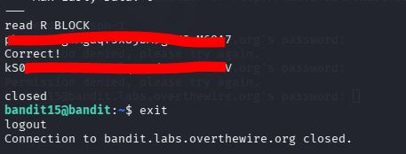

**At Level 16,** I scanned for open ports using ***\"nmap\"*** command
while specifying the ports (-p) range.

Then, I tested the open ports one after the other to confirm the one
that bears the SSH Private Key to the level 17. Having found the exact
ports and the correct SSH Private Key, I copied the entire key and saved
in a file on my localhost. I set the permission on it and logged in
using the ***\"ssh\"*** command specifying the file that has the saved
key together with the OTW server address. And I used ***"cat"*** command
to open the file that has the password.

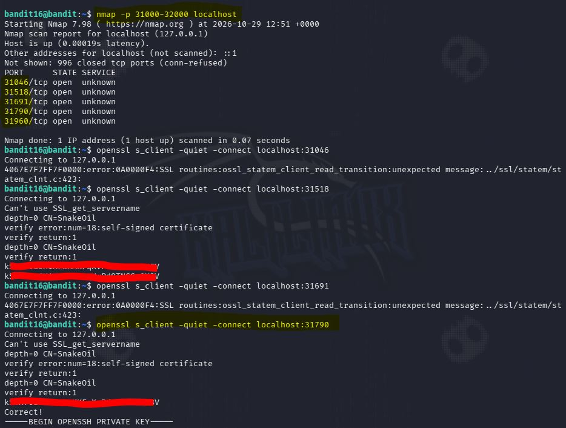

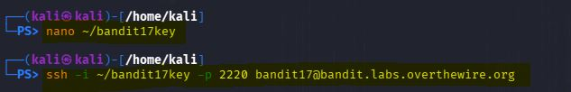 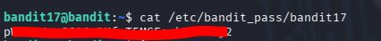

**At Level 17,** I used ***\"ls -l\"*** command to list the files in the
directory. Then I compared the difference with the ***\"diff\"***
command and piped it to filter ***\"grep\"*** command to see the only
change in the **"passwords.new"** file.

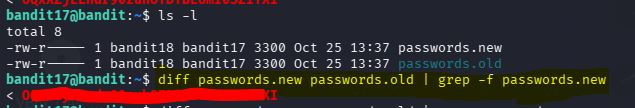

**At Level 18,** since the **".bashrc"** has been modified which
prevented me from accessing the interactive shell, I ran the
***\"cat\"*** command on the readme file directly through the SSH by
adding the command after the server connection details.

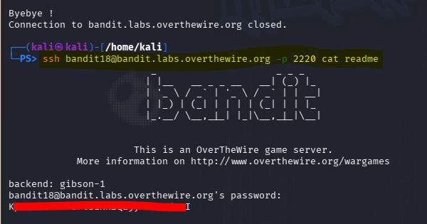

**At Level 19,** I used ***\"ls\"*** command to list the files, then run
the binary file as in ***\"./bandit20-do\",*** it returned with an
instruction on how to execute it, I followed the instruction by adding
the file owner \"bandit20\" to the argument.

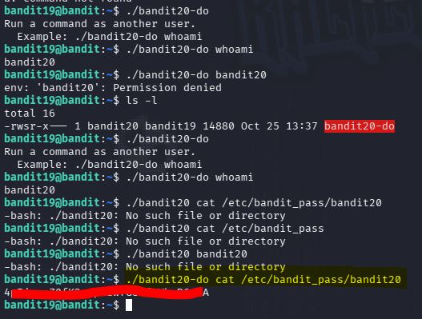

**At Level 20,** I opened two terminals; one to read and check the for
the matching password by running the bash file **\"./suconnect\"** in
the bandit20 user directory and the other for listening to the data sent
via port 1234. After reading is completed, the correct password was sent
to the terminal.

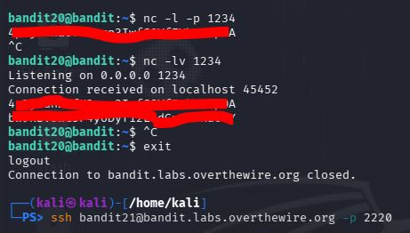 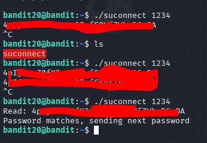
